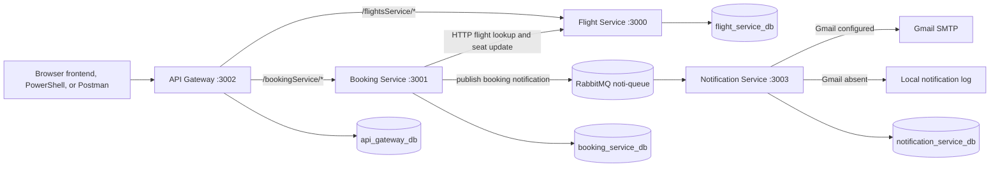

# Flight Booking System

A Windows-friendly local demo of a four-service flight booking system, now with a React browser frontend. Each backend service is an independent Node.js application with its own `package.json`, lockfile, environment file, Sequelize configuration, and MySQL database. This repository is the monorepo; do not clone separate service repositories.

The code was run on Windows 11 with Node.js 26.13.0, npm 11.20.0, MySQL 8.4.9, RabbitMQ 4.4.0, and Erlang/OTP 29.1.2. These are the tested versions, not enforced package engine requirements. A different laptop has not yet been verified. RabbitMQ 4.4.0 supports Erlang/OTP 29 according to the [RabbitMQ compatibility matrix](https://www.rabbitmq.com/docs/which-erlang).

The backend and browser frontend are intended for local development and recruiter demonstrations; this project is not described as production-ready.


## Run the browser frontend

The premium React + Vite frontend lives in [frontend/](./frontend). Start MySQL, RabbitMQ, and the four backend services using the setup instructions below, then open a separate PowerShell window at the repository root:

```powershell
Set-Location .\frontend
npm install
npm run dev
```

Open the Vite URL (normally `http://localhost:5173`). Its development proxy forwards `/api`, `/flightsService`, and `/bookingService` through the API Gateway at `http://localhost:3002`; the browser does not call individual microservices. See [frontend/README.md](./frontend/README.md) for the implemented flow and current API limitations.

## Architecture



| Service | Port | Responsibility | Database |
| --- | ---: | --- | --- |
| [API Gateway](./Flight-API-Gateway/README.md) | 3002 | Signup/signin, JWT validation, admin role checks, request limiting, and proxying to Flight and Booking | `api_gateway_db` |
| [Flight Service](./Flight-Service/README.md) | 3000 | Airports, cities, airplanes, flights, flight search, and seat availability | `flight_service_db` |
| [Booking Service](./Flight-Booking-Service/README.md) | 3001 | Booking records, simulated payment completion, booking expiry job, Flight Service calls, and RabbitMQ publishing | `booking_service_db` |
| [Notification Service](./Flights-Notification-Service/README.md) | 3003 | RabbitMQ consumption, local notification logging, optional Gmail delivery, and ticket API | `notification_service_db` |

Each service owns its schema and Sequelize migration history. Keep these four databases separate.

## Technology

- React + Vite + Tailwind CSS for the browser frontend in `frontend/`.
- Node.js and Express in all four backend services; each `npm run dev` runs `node --watch src/index.js`.
- Sequelize 6, Sequelize CLI 6, and `mysql2` for the service databases.
- API Gateway: `bcrypt`, `jsonwebtoken`, `express-rate-limit`, and `http-proxy-middleware`.
- Booking Service: `axios`, `amqplib`, and `node-cron`.
- Notification Service: `amqplib` and `nodemailer`.
- Winston logging in the services.
- RabbitMQ AMQP queue `noti-queue` for booking notifications.

There is no root `package.json`; install dependencies inside each service directory. Use `npm ci`, which installs from the checked-in lockfile.

## Prerequisites

1. **Git** to clone this repository.
2. **Node.js and npm.** Node.js 26.13.0 and npm 11.20.0 are the tested versions. Install Node.js from the [official downloads page](https://nodejs.org/en/download/).
3. **MySQL Server.** MySQL 8.4.9 was tested. The official [MySQL 8.4 Windows installation guide](https://dev.mysql.com/doc/refman/8.4/en/windows-installation.html) describes the MSI and Configurator setup.
4. **RabbitMQ and Erlang/OTP.** RabbitMQ 4.4.0 with Erlang/OTP 29.1.2 was tested. Install Erlang first, then RabbitMQ, following [RabbitMQ's Windows guide](https://www.rabbitmq.com/docs/install-windows) and [Erlang compatibility table](https://www.rabbitmq.com/docs/which-erlang). The application uses AMQP on port 5672; the management plugin is not required.
5. **PowerShell** for the commands below. MySQL Workbench can be used instead of the MySQL command-line client.

Docker is not required for this local setup.

## Clone the monorepo

```powershell
git clone https://github.com/bhupinder-14/Flight-Booking-System.git
Set-Location .\Flight-Booking-System
```

## Create local environment files

Each service loads a `.env` file from its own service directory. The `src/config/server-config.js` in each service resolves that directory and loads the file with `dotenv`. The `.env` files are intentionally local and ignored by Git; only the safe `.env.example` templates are tracked.

Copy the templates only where a local `.env` does not already exist. This preserves any existing local configuration:

```powershell
$serviceDirs = @(
  'Flight-API-Gateway',
  'Flight-Booking-Service',
  'Flight-Service',
  'Flights-Notification-Service'
)

foreach ($service in $serviceDirs) {
  $envFile = Join-Path $service '.env'
  if (-not (Test-Path $envFile)) {
    Copy-Item (Join-Path $service '.env.example') $envFile
  } else {
    Write-Host "Keeping existing $envFile"
  }
}
```

Edit each `.env` and replace the placeholders with values for that laptop. In particular:

- Set `DB_USERNAME` and `DB_PASSWORD` to the local MySQL account.
- Keep the four `DB_NAME` values distinct as shown in the templates.
- Keep `DB_HOST=127.0.0.1` for a native local MySQL server. The application configs otherwise fall back to the hostname `mysql`, which is generally used in container networks.
- Set a private, random `JWT_SECRET` in the Gateway's `.env`; do not commit or share it. The other Gateway settings should use the local service URLs and tested port.
- Set `RECEPIENT_EMAIL` in Booking Service if you want booking notifications addressed to a particular mailbox. The spelling is `RECEPIENT_EMAIL` in the code.
- `GMAIL_EMAIL` and `GMAIL_PASS` in Notification Service can remain blank for local notification logging. Configure them only if you want actual email delivery.
- `DB_DIALECT` is `mysql` in the templates; the configs default to `mysql` if it is omitted.

The four templates are [Gateway](./Flight-API-Gateway/.env.example), [Booking](./Flight-Booking-Service/.env.example), [Flight](./Flight-Service/.env.example), and [Notification](./Flights-Notification-Service/.env.example).

## Start MySQL and create the databases

Install and configure MySQL Server, including a local account that can create or use databases. The MySQL Windows installer can configure it as a Windows service. Check the service and TCP port in PowerShell:

```powershell
Get-Service -Name '*MySQL*'
Test-NetConnection 127.0.0.1 -Port 3306
```

If the service is stopped, start the service name shown on that machine from an elevated PowerShell window. On the tested laptop it was `MySQL80`:

```powershell
Start-Service -Name MySQL80
```

Connect without putting the password in the command line:

```powershell
mysql -u root -p
```

At the MySQL prompt, create only the four isolated project databases:

```sql
CREATE DATABASE IF NOT EXISTS flight_service_db CHARACTER SET utf8mb4 COLLATE utf8mb4_unicode_ci;
CREATE DATABASE IF NOT EXISTS booking_service_db CHARACTER SET utf8mb4 COLLATE utf8mb4_unicode_ci;
CREATE DATABASE IF NOT EXISTS api_gateway_db CHARACTER SET utf8mb4 COLLATE utf8mb4_unicode_ci;
CREATE DATABASE IF NOT EXISTS notification_service_db CHARACTER SET utf8mb4 COLLATE utf8mb4_unicode_ci;
```

`IF NOT EXISTS` leaves existing databases in place. If `mysql` is not on `PATH`, use MySQL Workbench to connect to `127.0.0.1:3306` and execute the same SQL. Match each database name to that service's `DB_NAME` in `.env`.

## Start RabbitMQ

RabbitMQ 4.4.0 requires a supported 64-bit Erlang/OTP installation on Windows. Install Erlang/OTP 29.1.2 first for the tested combination, then install RabbitMQ 4.4.0. The Windows installer registers and starts the RabbitMQ service.

Check the service and AMQP port:

```powershell
Get-Service -Name RabbitMQ
Test-NetConnection 127.0.0.1 -Port 5672
```

If needed, start it from elevated PowerShell:

```powershell
Start-Service -Name RabbitMQ
```

Booking publishes and Notification consumes from `noti-queue`. Both connections request `frameMax=8192`, which is required by the tested RabbitMQ 4.4.0 setup. No management plugin is needed for the application.

## Install dependencies

Run `npm ci` once inside each service. From the monorepo root:

```powershell
$serviceDirs = @(
  'Flight-API-Gateway',
  'Flight-Booking-Service',
  'Flight-Service',
  'Flights-Notification-Service'
)

foreach ($service in $serviceDirs) {
  Push-Location $service
  npm ci
  $installExitCode = $LASTEXITCODE
  Pop-Location
  if ($installExitCode -ne 0) {
    throw "npm ci failed in $service"
  }
}
```

## Run migrations and seed demo data

Run the commands from each service directory after configuring `.env` and creating its database. The project uses `src/config/config.js`, `src/migrations`, and (where present) `src/seeders`; these explicit paths are needed because the Sequelize CLI defaults do not match this layout.

```powershell
# Flight Service: create tables, then load airplane/city/airport/flight examples
Push-Location .\Flight-Service
npx sequelize-cli db:migrate --config src/config/config.js --migrations-path src/migrations --env development
npx sequelize-cli db:seed:all --config src/config/config.js --seeders-path src/seeders --env development
Pop-Location

# Booking Service: migrations only; there is no demo booking seeder
Push-Location .\Flight-Booking-Service
npx sequelize-cli db:migrate --config src/config/config.js --migrations-path src/migrations --env development
Pop-Location

# API Gateway: create user/role tables, then seed roles and sample users
Push-Location .\Flight-API-Gateway
npx sequelize-cli db:migrate --config src/config/config.js --migrations-path src/migrations --env development
npx sequelize-cli db:seed:all --config src/config/config.js --seeders-path src/seeders --env development
Pop-Location

# Notification Service: migrations only; there are no notification seeders
Push-Location .\Flights-Notification-Service
npx sequelize-cli db:migrate --config src/config/config.js --migrations-path src/migrations --env development
Pop-Location
```

Run Flight and Gateway seeders once for a fresh local database. The Gateway's seeded user password is not documented by the code; create a known customer with `/api/v1/user/signup` for the demo workflow instead. No destructive migration or database reset is required.

## Start the services

Start each service in its own PowerShell window from the monorepo root, in this order: Notification, Flight, Booking, then Gateway. MySQL and RabbitMQ should already be running.

```powershell
# PowerShell window 1
Set-Location .\Flights-Notification-Service
npm run dev
```

```powershell
# PowerShell window 2
Set-Location .\Flight-Service
npm run dev
```

```powershell
# PowerShell window 3
Set-Location .\Flight-Booking-Service
npm run dev
```

```powershell
# PowerShell window 4
Set-Location .\Flight-API-Gateway
npm run dev
```

The configured URLs are:

| Service | Base URL | Info route |
| --- | --- | --- |
| Flight Service | `http://localhost:3000` | `GET /api/v1/info` |
| Booking Service | `http://localhost:3001` | `GET /api/v1/info` |
| API Gateway | `http://localhost:3002` | `GET /api/v1/info` (requires `x-access-token`) |
| Notification Service | `http://localhost:3003` | `GET /api/v1/info` |

The info routes verify the HTTP handler only; they are not database-readiness checks. In PowerShell, verify an unauthenticated info route with:

```powershell
Invoke-RestMethod http://localhost:3000/api/v1/info
Invoke-RestMethod http://localhost:3001/api/v1/info
Invoke-RestMethod http://localhost:3003/api/v1/info
```

## Gateway APIs and authentication

Signup and signin are public Gateway routes:

| Method | Gateway route | Purpose |
| --- | --- | --- |
| `POST` | `/api/v1/user/signup` | Create a customer with `{ "email": "...", "password": "..." }` |
| `POST` | `/api/v1/user/signin` | Authenticate with the same body; `data` in the response contains the JWT |
| `GET` | `/api/v1/info` | Gateway info route; requires a token |
| `POST` | `/api/v1/user/role` | Admin-only; body `{ "id": 1, "role": "flight_company" }` |
| `POST` | `/api/v1/user/addAdminRole` | Admin-only; body `{ "id": 1 }` |
| `POST` | `/api/v1/user/addFlightCompanyRole` | Admin-only; body `{ "id": 1 }` |

Send the signin token in the `x-access-token` header. The Gateway proxies authenticated requests under `/flightsService/` to Flight Service and `/bookingService/` to Booking Service; it removes that prefix before forwarding.

## Example flight search, booking, and simulated payment

Run this in PowerShell after all services, migrations, and seeders are ready. Use a new email address each time you sign up. This example keeps the response values in variables instead of printing the token.

```powershell
$gateway = 'http://localhost:3002'
$email = 'recruiter-demo@example.com' # Use an address not already registered in this database
$password = 'replace-with-a-private-demo-password'
$json = @{ email = $email; password = $password } | ConvertTo-Json

$signup = Invoke-RestMethod -Method Post `
  -Uri "$gateway/api/v1/user/signup" `
  -ContentType 'application/json' `
  -Body $json

$signin = Invoke-RestMethod -Method Post `
  -Uri "$gateway/api/v1/user/signin" `
  -ContentType 'application/json' `
  -Body $json

$userId = $signup.data.id
$headers = @{ 'x-access-token' = $signin.data }

# Search seeded flights from Mumbai (MUM) to Delhi (DEL).
$search = Invoke-RestMethod -Method Get `
  -Uri "$gateway/flightsService/api/v1/flights?trips=MUM-DEL&travellers=1" `
  -Headers $headers
$flight = $search.data | Select-Object -First 1

# Request body field spelling is noofSeats (all lower-case except the S).
$bookingBody = @{
  flightId = $flight.id
  userId = $userId
  noofSeats = 1
} | ConvertTo-Json
$booking = Invoke-RestMethod -Method Post `
  -Uri "$gateway/bookingService/api/v1/bookings" `
  -Headers $headers `
  -ContentType 'application/json' `
  -Body $bookingBody

# Payment requires an idempotency header. This project simulates payment success.
$paymentHeaders = @{
  'x-access-token' = $signin.data
  'x-idempotency-key' = [guid]::NewGuid().ToString()
}
$paymentBody = @{
  totalCost = $booking.data.totalCost
  userId = $userId
  bookingId = $booking.data.id
} | ConvertTo-Json
Invoke-RestMethod -Method Post `
  -Uri "$gateway/bookingService/api/v1/bookings/payments" `
  -Headers $paymentHeaders `
  -ContentType 'application/json' `
  -Body $paymentBody
```

Flight search supports `trips` in `FROM-TO` form, plus optional `travellers`, `price`, `tripDate`, and `sort` query values. For example, `sort=price_DESC,departureTime_ASC` follows the implementation's sorting format.

Payment is a simulated state change in Booking Service. There is no external payment provider. The idempotency-key tracking is in memory, so it is not durable across service restarts.

## Notification behavior and Gmail setup

After the simulated payment succeeds, Booking Service publishes a JSON booking notification to RabbitMQ queue `noti-queue`. Notification Service consumes it.

- With `GMAIL_EMAIL` or `GMAIL_PASS` blank, Notification Service writes a clearly labeled local log containing selected booking and flight details, states that email was skipped, and acknowledges the message. This is notification logging, not email delivery.
- With both Gmail settings configured, it attempts to send the existing confirmation template. Transient SMTP failures are retried up to three times with a five-second delay. Permanent failures or exhausted retries are retained in `noti-queue.dead`; messages waiting for a retry use `noti-queue.retry`.
- For Gmail delivery, use a Google App Password where available; see [Google's App Password instructions](https://support.google.com/mail/answer/185833?hl=en-3). Put the sender address and app password only in the Notification Service `.env`. Never commit or paste them into tickets or logs.

The Notification Service also exposes `POST /api/v1/tickets` for its separate ticket-record endpoint. The booking queue consumer is a separate path.

## Troubleshooting

| Symptom | Check |
| --- | --- |
| `ECONNREFUSED` or Sequelize connection error | Confirm MySQL is running, port 3306 is reachable, `DB_HOST=127.0.0.1`, credentials are correct, and that service's `DB_NAME` exists. |
| Migrations cannot find `config/config.json` | Run the commands above from that service directory with `--config src/config/config.js --migrations-path src/migrations`. |
| RabbitMQ connection reset during startup | Confirm RabbitMQ service and port 5672. This project requests `frameMax=8192` in both active AMQP connections for the tested RabbitMQ 4.4.0 broker. |
| Notification logs say Gmail credentials are missing | This is expected for local logging mode. No email is sent; set both Gmail variables only if delivery is wanted. |
| Gateway signup/signin fails | Confirm Gateway migrations and seeders ran, DB settings are correct, `SALT_ROUNDS` is numeric, and `JWT_SECRET`/`JWT_EXPIRY` are configured. |
| Proxy request fails | Check that Flight and Booking are listening on 3000 and 3001, and that the Gateway `.env` targets use `http://localhost:3000` and `http://localhost:3001`. |
| `EADDRINUSE` | Another process is using that service port. Stop that process or configure the local environment/port plan consistently before restarting. |
| Gateway throws from bcrypt on a clean clone | Run `npm ci` in `Flight-API-Gateway`; the committed lockfile includes the Node 26-compatible transitive JWT dependency resolution. Avoid broad dependency upgrades. |

## Limitations

- The frontend is a local demo UI. Passenger names are collected in the browser but are not persisted by the current Booking API; My Trips uses browser-local demo history because there is no server-side booking-history endpoint.
- Payment success is simulated in Booking Service; no real payment gateway is integrated.
- Gmail delivery is optional. Blank credentials mean the notification is logged locally and acknowledged, not emailed.
- Services use separate databases and migration histories; do not point them all at one database.
- No cloud deployment or production hardening is included in this local demo guide.
